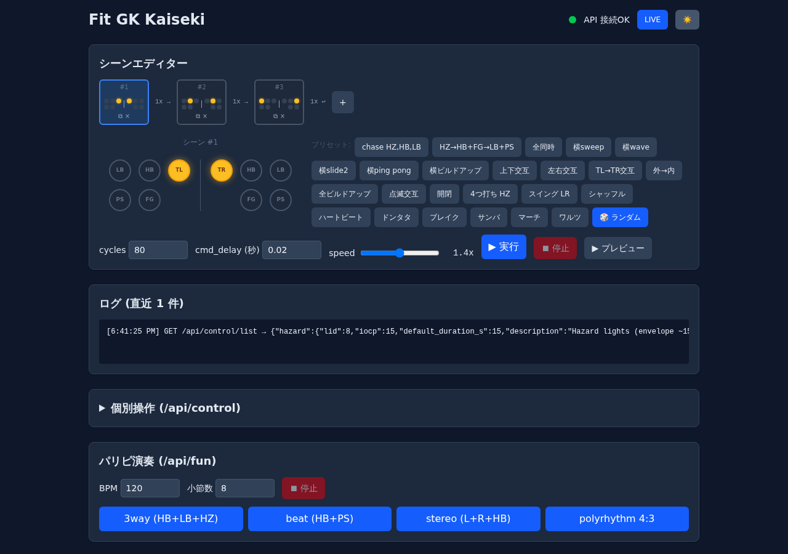
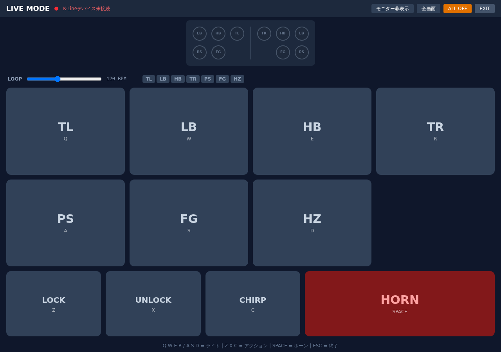

# kline-app — K-Line 制御 API + Web UI

> [fit-gk-kaiseki](../README.md) のサブプロジェクト。

自分の Honda Fit GK5 RS MT の OBD2 K-Line を解析した記録。 ECM(0x10) の IO Control 経由で MICU 配下のリレー (ハザード/ライト/ロック等) を任意のタイミングで叩けるようになったので、 ついでに FastAPI と Vue で操作 UI まで作った。

自分の車両 + 私的環境での研究目的限定です。 公道で勝手に光らせたりホーンを鳴らしたりはしないでください。 Honda とも当然無関係。

## できたこと

ECM(0x10) に対して以下を IO Control で叩けるところまで判明:

| 機能 | LID | IOCP | Envelope |
|---|---|---|---|
| ハザード | 0x08 | 0x0F | ~15s (ドア閉時 MICU即cancel) |
| 左ウィンカー | 0x0A | 0x0F | ~5s |
| 右ウィンカー | 0x0B | 0x0F | ~5s |
| ロービーム | 0x1C | 0x0F | ~15s |
| ハイビーム | 0x1D | 0x0F | ~15s |
| フォグ | 0x20 | 0x0F | ~15s |
| 車幅灯 | 0x25 | 0x0F | ~15s |
| 全ロック | 0x04 | 0x01 | パルス |
| 全解錠 | 0x05 | 0x01 | パルス |
| トランク開放 | 0x09 | 0x01 | パルス |
| ブザー/チャープ | 0x11 | 0x01 | 短 |
| ブザー/チャープ (持続) | 0x11 | 0x02 | StopDiag で停止 |
| ホーン | 0x26 | 0x01 | ~1s |
| ルームランプ | 0x02 | 0x1E | StopDiag で消灯 |
| カーゴエリアライト | 0x12 | 0x1E | StopDiag で消灯 |
| フロントワイパー Low | 0x19 | 0x05 | StopDiag で停止 |
| フロントワイパー Hi | 0x1A | 0x05 | StopDiag で停止 |
| リアワイパー | 0x0D | 0x05 | StopDiag で停止 |
| フロントウォッシャー | 0x1B | 0x05 | StopDiag で停止 |
| リヤウォッシャー | 0x0E | 0x05 | StopDiag で停止 |
| 左ウィンカー (別IOCP) | 0x0A | 0x05 | 0x0F でも可 |
| 右ウィンカー (別IOCP) | 0x0B | 0x05 | 0x0F でも可 |

別 ECU (0x72) 経由でも以下が判明:

| 機能 | LID | IOCP | ECU | Envelope |
|---|---|---|---|---|
| ロービーム | 0x01 | 0x01 | 0x72 | StopDiag(0x72宛)で消灯 |
| ロービーム | 0x01 | 0x05 | 0x72 | StopDiag(0x72宛)で消灯 |
| ロービーム | 0x01 | 0x0F | 0x72 | StopDiag(0x72宛)で消灯 |
| ロービーム+車幅灯 | 0x01 | 0x1E | 0x72 | StopDiag(0x72宛)で消灯 |

加えて StopDiagSession を組み合わせると envelope を任意の長さに切り詰められるので、 本来 15秒固定のハザードを 50ms の超短tap にしたり、 ハイビームを 8Hz で点滅させたり、 ハザード+ハイビーム+ロービームの3系統でビートを打たせたりできる。 詳しくは [../docs/findings.md](../docs/findings.md)。

## できなかったこと

ワイパー。 NRC=0x10 cluster は session 種別 / Security Access / IOCP / state byte / 別ECUアドレス / 全主要 vehicle state を試したが全部素通り。 純正 HDS が固有の preamble/auth を使ってる雰囲気で、 K-Line 系 aftermarket cable 単独だと届かない。 失敗の足跡は findings.md にまとめてある。

（補足: フロント/リアワイパー・ウォッシャー自体は IOCP=0x05 で叩けている。上記「行き止まり」の NRC=0x10 cluster は別系統のゲートで、後日 ECM(0x10) IOControl の全LID×全IOCP マトリクスを回しても全256 IOCPで generalReject のまま=IOCPの探し漏れではないことを確定済み。）

ミラー開閉・パワーウインドウの「読み書き」。 これらは MICU が監視する B-CAN 信号で、 K-Line 診断経由では到達できない。 ECM(0x10) にも MICU(0x72) 直接にも露出せず、 MICU は読み取りサービス(SID 0x21/0x22)も診断セッション(SID 0x10)も K-Line では全拒否。 実現には CAN インターフェース(B-CAN/F-CAN UDS)が要る。 詳細は findings.md の 2026-05-31 追記。

## 後日の全マトリクス探索 (2026-05-31)

ECM(0x10) の IOControl を **全LID 0x00-0x27 × 全IOCP 0x00-0xFF** で総当り(state=0固定・ホーン除外・取りこぼし0方式)。 既知マップが網羅的だったことを再確認しつつ、 新規に **LID 0x13 / IOCP 0x3C** を発見。 ただし PR は返るが(status 0x05)、 エンジンON/OFFいずれでも観測可能な出力を駆動せず、 実用機能としては未確定(非作動の内部制御の疑い)。 スキャナは `research/iocontrol_matrix.py`。

## ハード

- Honda Fit GK5 RS MT (型式 GK5)
- アリエクの FT232RL + L9637D OBD2 USB ケーブル — ELM327 エミュではなく、 純粋な K-Line トランシーバ
- ホスト: **macOS (Apple Silicon) で動作確認済み**。 Linux (Ubuntu/Debian) でも動く

K-Line 側は pyserial だけで完結するので、 OS 差はシリアルポート名しかない。 CAN 側 (`../can-live/`) の macOS 事情は別なので [../docs/macos-can.md](../docs/macos-can.md) 参照。

## 起動 (macOS)

```bash
git clone https://github.com/ritogk/fit-gk-kaiseki.git
cd fit-gk-kaiseki

# venv はリポジトリルート共有 (can-live と同居)。3.10+ 必須 (`X | None` 記法を使うため)
uv venv --python 3.12 .venv
uv pip install --python .venv/bin/python -r kline-app/requirements.txt
```

ケーブルを挿してポート名を確認する。 FTDI なので `cu.usbserial-` + 個体シリアルになる (ケーブルを変えない限り不変):

```bash
ls /dev/cu.usbserial-*
# 例: /dev/cu.usbserial-A50285BI
```

起動:

```bash
cd kline-app
KLINE_PORT=/dev/cu.usbserial-A50285BI ../.venv/bin/uvicorn api.main:app --host 0.0.0.0 --port 8000
```

ブラウザで `http://127.0.0.1:8000/` 開けば UI、 `/docs` で Swagger。

`web/dist` はビルド済みで FastAPI が `/` にマウントするため、 **`npm install` も Vite も要らない**。 フロントを触る時だけ別ターミナルで `cd web && npm install && npx vite --port 5173`。

> `./run.sh` (および `../run-kline.sh`) は Linux 向け。 デフォルトポートが `/dev/ttyUSB0` 固定で、 かつ `npx vite` を叩くので `web/node_modules` が無いと落ちる。 macOS では上の uvicorn 直起動を使う。

### ポートのパーミッション

macOS では `/dev/cu.usbserial-*` が `crw-rw-rw-` で生えるので **何もしなくてよい**。

Linux の場合のみ以下が要る:

```bash
sudo chmod 666 /dev/ttyUSB0          # USB抜き差し毎に必要
# または:
sudo usermod -aG dialout $USER && newgrp dialout
```

## CAN 接続 (B-CAN / F-CAN)

K-Line で届かない領域（ミラー/パワーウインドウ等の B-CAN 信号）を狙うための CAN 側のつなぎ方。

アダプタは Geschwister Schneider / candleLight 系 (USB ID `1d50:606f`)。 **macOS では python-can の `gs_usb` バックエンドを使う** — SocketCAN は Linux カーネル機能なので macOS には存在せず、`ip` / `candump` / `cansend` も入らない。 gs_usb は libusb 経由のユーザ空間実装なので、 カーネル側の準備なしにそのまま動く。

```bash
brew install libusb
uv pip install --python .venv/bin/python gs_usb pyusb
```

### 検出確認

```bash
.venv/bin/python -c "from gs_usb.gs_usb import GsUsb; print(GsUsb.scan())"
```

1台以上返れば OK。 `[]` ならアダプタ未接続。 macOS 固有の権限設定・ドライバ署名・Zadig 相当の作業はいずれも不要。

### 受信 / 送信 / ログ

can-utils (`candump` / `cansend` / `canplayer` / `cangw`) は Linux 専用だが、 **python-can が同等の CLI を同梱している**。 venv に入るのでそのまま使える。

```bash
# 受信を流し見 (candump 相当)
.venv/bin/can_viewer -i gs_usb -c 0 --bitrate 500000

# ログ記録 (candump -l 相当)。Ctrl+C で停止
.venv/bin/can_logger -i gs_usb -c 0 --bitrate 500000 -f drive.log

# 再生 (canplayer 相当)
.venv/bin/can_player -i gs_usb -c 0 --bitrate 500000 drive.log
```

ビットレートは `ip link` で事前に設定するのではなく、 **起動時に `--bitrate` で渡す**。 これが SocketCAN との一番大きな運用差。 バスを変えるときはプロセスを立て直す。

- **B-CAN** (ミラー/パワーウインドウ。Honda 低速): `--bitrate 125000`
- **F-CAN** (パワートレイン/シャシ): `--bitrate 500000`

送信は python から:

```python
import can
bus = can.interface.Bus(interface="gs_usb", channel=0, index=0, bitrate=500000)
bus.send(can.Message(arbitration_id=0x123, data=b"\xde\xad\xbe\xef", is_extended_id=False))
```

ISO-TP / UDS も macOS で通る。 Linux カーネルモジュール `can-isotp.ko` は不要で、 `can-isotp` パッケージの純 Python 実装が gs_usb の上に載る（仮想バスで往復検証済み）。

### ビットレートの見分け方

`ip -s -d link show can0` に相当する状態カウンタは gs_usb には無いので、 **フレームが出るかどうかで判断する**:

- `can_viewer` にフレームが流れる → ビットレート正解
- 完全に無音 → レート不一致か、 配線未接続か、 挿した箇所にそのバスが来ていない

レートを変えて試すのが早い。 実測では F-CAN は **500k** で `091 / 130 / 140 / 158 / 17C / 1A4 / 1A6 / 1DC / 320 / 324 / 328` 等が流れる。 B-CAN は **125k** 想定（未確定、要検証）。 Honda は系統によって 33.3k のこともある。

### Linux で動かす場合

`gs_usb` アダプタは Linux カーネルが `can0` としてネイティブ認識するので、 SocketCAN をそのまま使う (`slcand` 不要):

```bash
sudo ip link set can0 up type can bitrate 500000
candump -t d can0
cansend can0 '123#DEADBEEF'
sudo ip link set can0 down        # ビットレート変更前
```

> **Linux で `gs_usb` バックエンドを使ってはいけない。** `gs_usb.start()` がカーネルドライバを detach するため `can0` が消え、 candump 等と共存できなくなる。 Linux=socketcan / macOS=gs_usb で固定する。

> 注意: B-CAN は OBD コネクタに出ていない車種があり、 その場合は車内ハーネス（MICU 近辺）への割り込みが必要。

詳しい調査記録（性能実測、 Linux が本当に要る境界、 代替手段）は [../docs/macos-can.md](../docs/macos-can.md)。

## 同時点灯の仕組み

K-Line (10400bps, 半二重) はシリアル通信なので物理的に同時送信はできない。 代わりに以下の手順で「同時に見える」点灯を実現している:

```
例: [2,5] (HB + FG 同時点灯)

1. io_control(HB) 送信 → ECMがHBを点灯
2. sleep(cmd_delay)      → 応答がバスから消えるのを待つ
3. reset_input_buffer()  → 応答バイトを読み捨て
4. io_control(FG) 送信 → ECMがFGを点灯 (HBはまだ点いている)
5. sleep(cmd_delay)      → 同上
6. reset_input_buffer()
7. on_s 待機             → 両方点灯中
8. StopDiag 送信         → 全ライト一括消灯
```

ポイント:

- io_control で点けたライトは StopDiag が来るまで消えない (ECMのenvelopeが維持する)
- 応答を `s.read()` でパースせず `sleep` + `reset_input_buffer()` で捨てることで、 read のタイムアウト待ちを省略
- `cmd_delay` (デフォルト 20ms) が1LIDあたりの間隔。 10400bps で コマンド14byte (~13ms) + 応答7byte (~7ms) = ~20ms が物理下限
- 実測では 18ms 前後まで詰められるが、 それ以下だとバス衝突で一部ライトが不発になる

## ライブモードのバッチ処理

ライブモードのワーカースレッドは、キューからメッセージを取得後 **15ms 待機**してから残りのメッセージをまとめて1バッチとして処理する。

K-Line では個別ライトの消灯ができず、消灯時は `StopDiag`（全消灯）→ 残りを `refire`（再点灯）する必要がある。 連打時にこの `StopDiag → refire` が毎回走ると ECM が追いつかずライトが残る問題があったため、15ms のバッファで複数イベントをまとめ、最終状態だけを K-Line に1回送る設計にしている。

```
例: HB + LB 同時押し → 両方離す

旧: off(HB) → StopDiag → refire(LB) → off(LB) → StopDiag  ← ECMが追いつかない
新: off(HB) + off(LB) を15msでまとめ → StopDiag 1回       ← 安定
```

### 送信間隔（TX pacing）

同時押しで「片方が点かない」ことがある問題を追った記録。

- **原因**: K-Line は単線・半二重。前コマンドへの ECM 応答（ISO 14230 P2, ~25-50ms）がバス上に残っているうちに次フレームを送ると衝突し、片方の io_control が握り潰される。1バッチ内で複数ライトを連射する同時押し時に顕在化していた（手で一瞬ずらすと自然に間隔が空くので光る）。
- **対策**: フレーム送信前に `_TX_GAP` を **前回送信からの経過時間で** 確保する（`kline/live.py: _pace`）。単発・連打は前回送信から十分空いているので待たず、連射時だけ間隔が入る。`KLINE_TX_GAP` 環境変数で上書き可。
- **回り道**: 当初は毎回 `read()` で応答を読み切る実装にしたが、1コマンドが必ず ~50ms ブロックしてワーカーが遅くなり、HB↔LB の高速トグルがバッチ内で on/off 相殺して取りこぼした。「毎回待つ」ではなく「足りない時だけ待つ」間隔ベースに変更して解決。
- **詰め**: gap を 50ms から下げていくと 4灯同時押しのスパン（3×gap）が縮む。物理下限 ~20ms（13B要求 + 7B応答 @10400bps）まで詰めて実機で安定確認、デフォルト `_TX_GAP=0.02` に設定。4灯で 150ms → ~60ms。

## CLI で叩きたい場合

`KLINE_PORT` は API サーバと同じものを渡す。 毎回書くのが面倒なら `export KLINE_PORT=/dev/cu.usbserial-A50285BI` しておく。

```bash
export KLINE_PORT=/dev/cu.usbserial-A50285BI   # macOS。Linux は /dev/ttyUSB0

../.venv/bin/python scripts/fire.py list
../.venv/bin/python scripts/fire.py hazard 5
../.venv/bin/python scripts/play.py 3way 120 8
../.venv/bin/python scripts/play.py pattern 1D 0F 0.1 0.1 12
```

シリアルポートはプロセス間で排他ではないので、 **API サーバを止めてから叩くこと**。 同時に開くと双方のフレームが混ざる。

`research/` の中身は解析中に書き散らかしたスクリプトをそのまま残してある。 行き止まりも含めて、 後から再現するときの参考用。

## API

`/api/control/{name}` で個別操作、 `/api/fun/*` でビート系。 操作詳細は Swagger 見るのが早い。

## 構成

```
kline/      K-Line client (ISO 14230 / KWP2000) + ライブセッション
api/        FastAPI ルーター + WebSocket (ライブモード)
web/        Vue 3 + TypeScript + Vite SPA (Tailwind CSS v4)
scripts/    CLI ラッパー
research/   解析中の生スクリプト (失敗込み)
../docs/    findings.md + スクリーンショット (リポジトリルート共有)
```

## UI

### シーンエディター


### ライブ演奏モード


## Launchpad X でライブ演奏（物理パッドコントローラー / Linux 専用）

> **このセクションは Linux 専用。** ブリッジ (`launchpad/main.c`) が ALSA シーケンサと `/dev/uinput` に直接依存しているため、 macOS ではビルドも実行もできない。 Mac でライブモードを使う場合はブラウザのキーボード入力で操作する（パッド配置と同じキーが割り当ててある）。

Novation Launchpad X を USB 接続し、ライブモード用の物理キーボードとして使える。
パッドを押すと対応するキーイベントが発火し、ブラウザのライブモードをそのまま操作できる。

### 必要なもの

- Novation Launchpad X（USB 接続）
- Linux ホスト
- ALSA 開発ライブラリ: `sudo apt install libasound2-dev`
- root 権限（`/dev/uinput` へのアクセスに必要）

### ビルド・起動

```bash
cd launchpad
make                # 初回のみビルド
cd ..

./run-keyboard.sh           # 起動（前のプロセスも自動で kill）
./run-keyboard.sh stop      # 停止
./run-keyboard.sh restart   # 再起動
```

web (API + Vite) は `./run.sh`、keyboard は `./run-keyboard.sh` と起動スクリプトが分かれている。
`run-keyboard.sh` は `launchpad/run.sh` の薄いラッパーなので、`cd launchpad && ./run.sh` でも同じ。

操作可能なパッドだけが光り、それ以外は暗くなる。押下時は白く光る。終了は `Ctrl+C`。

### パッド配置（左下 3 行）

```
[Q]  [W]  [E]  [V]       ← ライト上段（橙）+ 全停止（赤）: ロービーム / ハイビーム / ハザード / 全停止
[A]  [S]  [D]  [R]       ← ライト下段（黄）: 車幅灯 / フォグ / 左ウィンカー / 右ウィンカー
[Z]  [X]  [C]  [SPACE]   ← アクション（青）+ ホーン（赤）: ロック / アンロック / チャープ / ホーン
```

### トラブルシューティング

- **"Device or resource busy"**: `sudo killall -9 launchpad-kb amidi` で前のプロセスを殺す
- **LED が光らない**: Programmer モードでは `hw:X,0,1`（MIDI ポート）を使う。DAW ポート（`hw:X,0,0`）では LED は制御できない
- **パッドを押しても反応しない**: `amidi -p hw:X,0,1 -d` で MIDI データが来ているか確認

詳細は [launchpad/](launchpad/) 内のソースコードと `keymap-live.conf` を参照。

## ライセンス

MIT。 [../LICENSE](../LICENSE) 参照。 自分の車で、 自分のリスクで遊んでください。
